<div align="center">



**[Open the interactive terminal →](https://rewantth.github.io/)**
<br><sub>a simulated Kali desktop with projects, writeups and live GitHub stats</sub>

</div>

```console
┌──(kali㉿kali)-[~/projects]
└─$ ls -1
sentinel-travel/  sentinelops/  phishguard-x/  securewave-network/  cdsa-study-tracker/  inbox-dashboard/
```

Defensive security projects: detection, alert triage, secure network design and data protection. Everything runs on synthetic or self-owned data.

---

## [`sentinel-travel/`](https://github.com/rewantth/SentinelTravel)

> Identity threat detection and impossible-travel analytics, presented as a live SOC console.

**Stack:** FastAPI · React · SQLite · WebSockets · Leaflet · Recharts

```console
┌──(kali㉿kali)-[~/projects/sentinel-travel]
└─$ tree --modules
.
├── detection    travel speed (Haversine), per-user baselines, risk and confidence scoring, MITRE ATT&CK mapping
├── signals      impossible travel, VPN/proxy and TOR use, MFA failures, bad IP reputation, credential stuffing
├── console      live alert stream, maps, analyst notes, audit log, kill-switch actions, SIEM-style exports
└── data         15 synthetic attack scenarios, no real users or logs
```

Identity attacks look like normal logins until timing, location, device and MFA are correlated. This turns authentication events into explainable alerts and shows the reasoning to the analyst.

---

## [`sentinelops/`](https://github.com/rewantth/sentinelops-soc-console)

> SOC alert triage and investigation console with MITRE ATT&CK mapping and case tracking.

**Stack:** Flask · SQLAlchemy · SQLite · Chart.js · JavaScript

```console
┌──(kali㉿kali)-[~/projects/sentinelops]
└─$ tree --modules
.
├── ingest       simulated alert generation, JSON ingestion into SQLite
├── triage       severity and status filters, MITRE ATT&CK classification, IP enrichment with a safe no-key fallback
├── cases        new to closed workflow, timeline with second-level timestamps, analyst notes
└── reporting    live simulated feed, charts, investigation export as JSON, MTTD and MTTR metrics
```

Defensive and blue-team only: no offensive functionality, malware or harmful payloads.

---

## [`phishguard-x/`](https://github.com/rewantth/phishguard-x)

> Explainable phishing detection and email threat analysis.

**Stack:** Python · Flask · pytest

```console
┌──(kali㉿kali)-[~/projects/phishguard-x]
└─$ tree --modules
.
├── email-checks    urgency, coercion, credential bait, scam-like phrasing
├── sender-checks   impersonation, free-provider misuse, brand mismatch
├── url-checks      shorteners, IP links, risky TLDs, redirects, obfuscation, displayed-vs-actual links
└── scoring         weighted category scores, severity, confidence and a verdict
```

The engine is rule-based on purpose, so every finding is explainable: each one carries a rule id, evidence, severity and remediation. It includes sample phishing and legitimate messages and unit tests for scoring.

---

## [`securewave-network/`](https://github.com/rewantth/Enterprise-Secure-Network-Packet-Tracer) · [project page](https://rewantth.github.io/Enterprise-Secure-Network-Packet-Tracer/)

> An enterprise branch network with VLAN segmentation, a DMZ and routed security zones, built in Cisco Packet Tracer.

**Stack:** Cisco Packet Tracer · VLANs · SVIs · DHCP · DNS · AAA

```console
┌──(kali㉿kali)-[~/projects/securewave-network]
└─$ tree --modules
.
├── segmentation   8 VLANs, a guest VLAN, and a black-hole VLAN 999 for unused ports
├── routing        layer 3 inter-VLAN routing on a core switch, edge router link, trunks to 5 access switches
├── services       DHCP for every user VLAN, a DMZ with DNS, web and AAA servers
└── evidence       device configs, IP and VLAN plan, test checklists and a security policy matrix
```

**Next:** ACL-based access control between VLANs, port security, and OSPF between the edge router and core.

---

## [`cdsa-study-tracker/`](https://github.com/rewantth/cdsa-study-tracker) · [live page](https://rewantth.github.io/cdsa-study-tracker/)

> A free, offline study tracker for the HTB SOC Analyst path and the CDSA exam. No accounts, no backend, no network requests.

**Stack:** single-file HTML · JavaScript · CSS

- 341 checkboxes across 25 modules, with a daily plan that re-plans from what is left
- Spaced-repetition review queue, a focus timer, and streaks that ignore rest days
- Per-module guides, hints, notes, a problem roadmap and an exam readiness tab
- Progress stays in the browser, with download and restore backups

Privacy by design: with no analytics and no requests to any server, nothing about the user can leak.

---

## `inbox-dashboard/` &nbsp;<sub>private source</sub>

> A security-first dashboard that turns the emails in a mailbox into a live, encrypted web page.

**Stack:** Python 3.12 · Gmail API (OAuth) · WebCrypto · vanilla JavaScript · GitHub Actions

| Threat | Control |
|---|---|
| Mailbox exposure | Read-only OAuth scope. The token lives only as an encrypted CI secret, visible to one build step. |
| Someone downloads the data file | AES-256-GCM, PBKDF2-SHA-256 with 1,000,000 rounds, a fixed per-project salt and a random IV for every file. |
| Script injection in the page | A Content Security Policy generated from the page's own script hash. Injected scripts and inline handlers are refused. |
| Stolen browser storage | A non-extractable `CryptoKey` is kept instead of the passphrase, and Lock deletes it. |
| Hijacked dependency or action | Every Action pinned to a commit and every package pinned to a version. |
| Over-powered CI | `permissions: {}` by default, and a deploy key that can write to exactly one repository. |

85 automated checks across four suites cover the classifier, alerts, security controls and cache.

---

```console
┌──(kali㉿kali)-[~/projects]
└─$ echo "more to come"
more to come
```
