<div align="center">

[home](#home) · [about](#about) · [projects](#projects) · [focus](#focus) · [blog](#blog) · [stats](#stats)

</div>

<a name="home"></a>
<a href="https://rewantth.dev/"></a>

<div align="center"><b><a href="https://rewantth.dev/">▶ open the interactive terminal</a></b> &nbsp;·&nbsp; type <code>help</code> there to run commands</div>

<a name="about"></a>


<a name="projects"></a>


<a name="focus"></a>


<a name="blog"></a>


<a name="stats"></a>


<details>
<summary>text version: links, project details, writeups, stats</summary>

### about

I am a cybersecurity student who learns by building. Every project here is something I can run, break and explain, and each one is on the defender's side: spotting attacks in data, triaging alerts, segmenting networks and protecting information with encryption.

Everything uses synthetic or self-owned data, and I only test on systems I am authorized to.

| right now | |
|---|---|
| `studying` | the HTB SOC Analyst path and the CDSA exam (I built the study tracker for it) |
| `building` | ACLs, port security and OSPF for securewave-net |
| `writing` | short writeups on the security decisions behind my projects |

| toolbox | |
|---|---|
| `languages` | `Python` `JavaScript` `HTML` `CSS` |
| `web / data` | `FastAPI` `Flask` `React` `SQLite` `SQLAlchemy` `Chart.js` |
| `security` | `MITRE ATT&CK` `AES-256-GCM` `PBKDF2` `CSP` `WebCrypto` `VLANs` `DMZ` `AAA` |
| `tools` | `Kali Linux` `Cisco Packet Tracer` `GitHub Actions` `pytest` |

### projects

**Code:** [sentinel-travel](https://github.com/rewantth/SentinelTravel) · [sentinelops](https://github.com/rewantth/sentinelops-soc-console) · [phishguard-x](https://github.com/rewantth/phishguard-x) · [securewave-net](https://github.com/rewantth/Enterprise-Secure-Network-Packet-Tracer) · [cdsa-study-tracker](https://github.com/rewantth/cdsa-study-tracker) · inbox-dashboard <sub>(private)</sub>

<details>
<summary><b>sentinel-travel/</b> &nbsp;·&nbsp; identity threat detection and impossible-travel analytics, shown as a live SOC console.</summary>

**Stack:** FastAPI · React · SQLite · WebSockets · Leaflet · Recharts<br>**Status:** portfolio project, synthetic data only<br>**Links:** [code](https://github.com/rewantth/SentinelTravel)

```console
┌──(kali㉿kali)-[~/projects/sentinel-travel]
└─$ tree --modules
.
├── detection    travel speed (Haversine), per-user baselines, risk and confidence scoring, MITRE ATT&CK mapping
├── signals      impossible travel, VPN/proxy and TOR use, MFA failures, bad IP reputation, credential stuffing
├── console      live alert stream, maps, analyst notes, audit log, kill-switch actions, SIEM-style exports
└── data         15 synthetic attack scenarios, no real users or logs
```

Identity attacks look like normal logins until timing, location, device and MFA are correlated. This turns authentication events into explainable alerts and shows the reasoning to the analyst.

</details>

<details>
<summary><b>sentinelops/</b> &nbsp;·&nbsp; SOC alert triage and investigation console with MITRE ATT&CK mapping and case tracking.</summary>

**Stack:** Flask · SQLAlchemy · SQLite · Chart.js · JavaScript<br>**Status:** portfolio project, safe simulated alerts<br>**Links:** [code](https://github.com/rewantth/sentinelops-soc-console)

```console
┌──(kali㉿kali)-[~/projects/sentinelops]
└─$ tree --modules
.
├── ingest       simulated alert generation, JSON ingestion into SQLite
├── triage       severity and status filters, MITRE ATT&CK classification, IP enrichment with a safe no-key fallback
├── cases        new to closed workflow, timeline with second-level timestamps, analyst notes
└── reporting    live simulated feed, charts, investigation export as JSON, MTTD and MTTR metrics
```

Defensive and blue-team only: no offensive functionality, malware or harmful payloads.

</details>

<details>
<summary><b>phishguard-x/</b> &nbsp;·&nbsp; explainable phishing detection and email threat analysis.</summary>

**Stack:** Python · Flask · pytest<br>**Status:** portfolio project<br>**Links:** [code](https://github.com/rewantth/phishguard-x)

```console
┌──(kali㉿kali)-[~/projects/phishguard-x]
└─$ tree --modules
.
├── email-checks urgency, coercion, credential bait, scam-like phrasing
├── sender-checksimpersonation, free-provider misuse, brand mismatch
├── url-checks   shorteners, IP links, risky TLDs, redirects, obfuscation, displayed-vs-actual links
└── scoring      weighted category scores, severity, confidence and a verdict
```

The engine is rule-based on purpose, so every finding is explainable: each carries a rule id, evidence, severity and remediation. It includes sample phishing and legitimate messages and unit tests for scoring.

</details>

<details>
<summary><b>securewave-net/</b> &nbsp;·&nbsp; an enterprise branch network with VLAN segmentation, a DMZ and routed security zones, built in Cisco Packet Tracer.</summary>

**Stack:** Cisco Packet Tracer · VLANs · SVIs · DHCP · DNS · AAA<br>**Status:** core network complete. ACLs, port security and OSPF planned<br>**Links:** [code](https://github.com/rewantth/Enterprise-Secure-Network-Packet-Tracer) · [project page](https://rewantth.github.io/Enterprise-Secure-Network-Packet-Tracer/)

```console
┌──(kali㉿kali)-[~/projects/securewave-net]
└─$ tree --modules
.
├── segmentation 8 VLANs, a guest VLAN, and a black-hole VLAN 999 for unused ports
├── routing      layer 3 inter-VLAN routing on a core switch, edge router link, trunks to 5 access switches
├── services     DHCP for every user VLAN, a DMZ with DNS, web and AAA servers
└── evidence     device configs, IP and VLAN plan, test checklists and a security policy matrix
```

Next: ACL-based access control between VLANs, port security, and OSPF between the edge router and core.

</details>

<details>
<summary><b>cdsa-study-tracker/</b> &nbsp;·&nbsp; a free, offline study tracker for the HTB SOC Analyst path and the CDSA exam. no accounts, no backend, no network requests.</summary>

**Stack:** single-file HTML · JavaScript · CSS<br>**Status:** live, progress never leaves the browser<br>**Links:** [code](https://github.com/rewantth/cdsa-study-tracker) · [live page](https://rewantth.github.io/cdsa-study-tracker/)

```console
┌──(kali㉿kali)-[~/projects/cdsa-study-tracker]
└─$ tree --modules
.
├── plan         341 checkboxes across 25 modules, with a daily plan that re-plans from what is left
├── review       spaced-repetition queue, focus timer, streaks that ignore rest days
├── guides       per-module guides, hints, notes, a problem roadmap and an exam readiness tab
└── privacy      progress stays in the browser, with download and restore backups
```

Privacy by design: with no analytics and no requests to any server, nothing about the user can leak.

</details>

<details>
<summary><b>inbox-dashboard/</b> &nbsp;·&nbsp; a security-first dashboard that turns the emails in a mailbox into a live, encrypted web page.</summary>

**Stack:** Python 3.12 · Gmail API · WebCrypto · vanilla JS · GitHub Actions<br>**Status:** running, source private<br>**Links:** private source

```console
┌──(kali㉿kali)-[~/projects/inbox-dashboard]
└─$ tree --modules
.
├── mail-reader  read-only Gmail OAuth, incremental download with a cache
├── classifier   rule engine: sender, subject and body patterns decide the category and stage
├── vault        AES-256-GCM encryption, decrypted only in the browser
└── pipeline     scheduled build in a private repo, one-way publish to a public page
```

Security: read-only OAuth scope · AES-256-GCM with PBKDF2-SHA-256 (1,000,000 rounds) · strict Content Security Policy from the page's own script hash · a non-extractable CryptoKey instead of the passphrase · every Action pinned to a commit · a deploy key that writes to one repository. 85 automated checks.

</details>

### focus

| | |
|---|---|
| `detection` | spot attacks in data: impossible travel, phishing, alert triage and MITRE ATT&CK mapping |
| `defence` | segment networks, apply least privilege and protect data with encryption |
| `explainable` | every alert, score and finding shows the evidence behind it |
| `method` | synthetic or self-owned data only, and authorized targets only |

### writeups

| date | writeup | summary |
|---|---|---|
| 2026-11-20 | **[A dashboard that can't leak its own data](blog/inbox-dashboard-security.md)** | The threat model first, then the controls it produced. |
| 2026-11-19 | **[Keep the key, not the passphrase](blog/keep-the-key.md)** | Remember a user without ever storing their secret. |

### stats

<!-- stats:start -->
```console
┌──(kali㉿kali)-[~/stats]
└─$ stats --github rewantth

user       rewantth
repos      14 public
followers  0
following  0
stars      0
```

**Public activity, last 13 weeks** <sub>(one square per day, darker means more)</sub>

```text
mon  · · · · · · · · · · · · ▒
tue  · · · · · · · · · ░ · · ░
wed  · · · · · · · · · · · · ░
thu  · · · · · · · · · · · · ·
fri  · · · · · · · · · · · █  
sat  · · · · · · · · · · · ▒  
sun  · · · · · · · · · · · ░  
```

**Languages** <sub>by repository count</sub>

```text
JavaScript  ████         40%
Python      ███          30%
HTML        ██           20%
CSS         █            10%
```

**Recently updated**

| repository | about | language | updated |
|---|---|---|---|
| [cdsa-study-tracker](https://github.com/rewantth/cdsa-study-tracker) | Free, private, offline study tracker for the HTB SOC Analyst path and CDSA exam. No accounts, no tracking. | HTML | 2026-11-03 |
| [Enterprise-Secure-Network-Packet-Tracer](https://github.com/rewantth/Enterprise-Secure-Network-Packet-Tracer) | Enterprise network simulation with VLANs, DHCP, DMZ DNS/Web, Edge routing, and Packet Tracer evidence | - | 2026-05-31 |
| [SentinelTravel](https://github.com/rewantth/SentinelTravel) | - | JavaScript | 2026-05-03 |
| [sentinelops-soc-console](https://github.com/rewantth/sentinelops-soc-console) | A cinematic full-stack SOC alert triage console with simulated alert ingestion, MITRE ATT&CK mapping, IP enrichment, case tracking, and real-time threat-market visualizations. | JavaScript | 2026-04-28 |
| [phishguard-x](https://github.com/rewantth/phishguard-x) | - | Python | 2026-03-28 |
| [x86-website](https://github.com/rewantth/x86-website) | - | HTML | 2025-03-23 |

<sub>This block is rebuilt every day by a small GitHub Action from public data only. Private repositories are never shown. Last refresh: 2026-11-26.</sub>
<!-- stats:end -->

</details>
